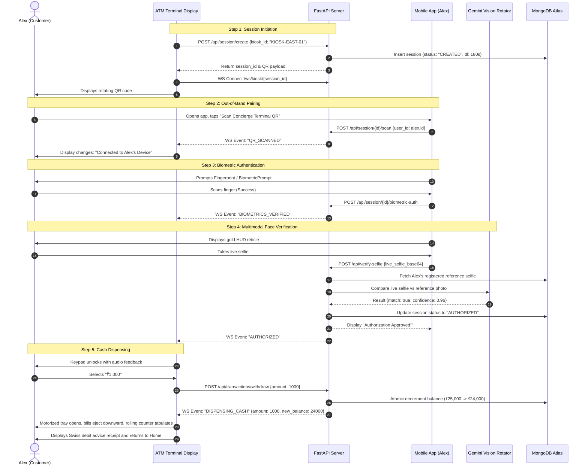
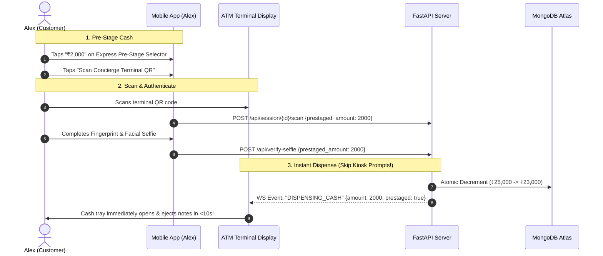
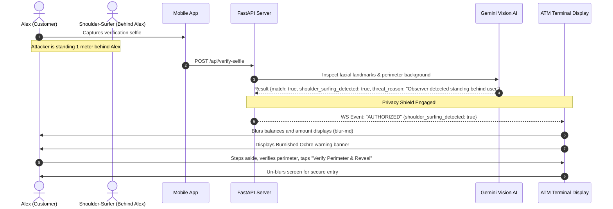
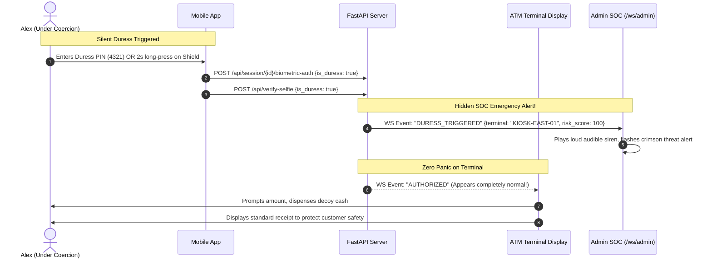
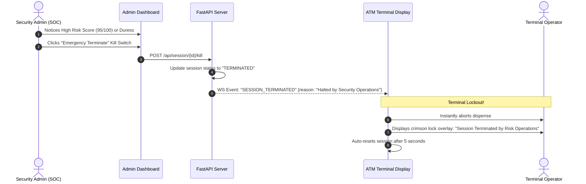
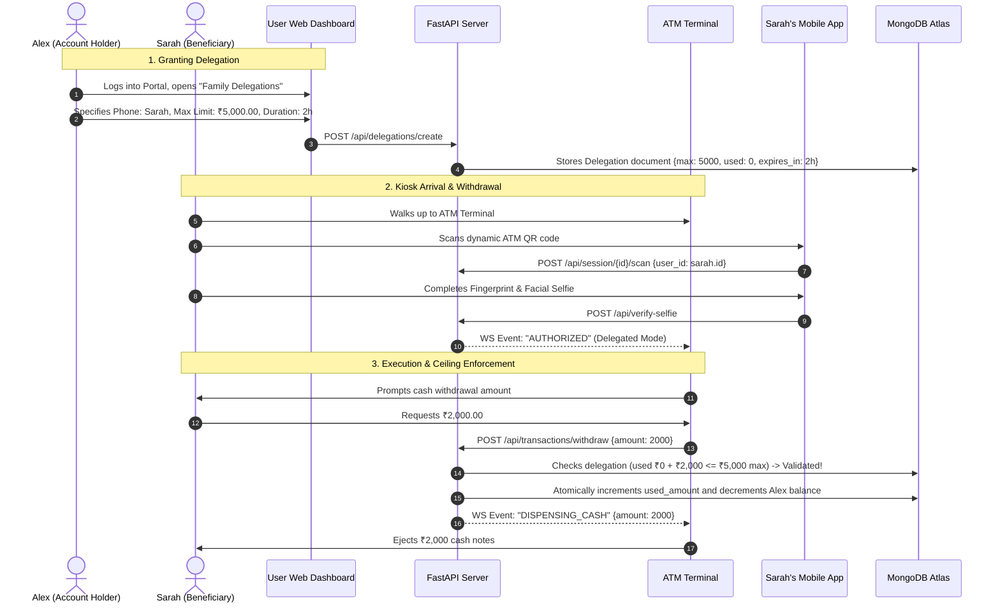
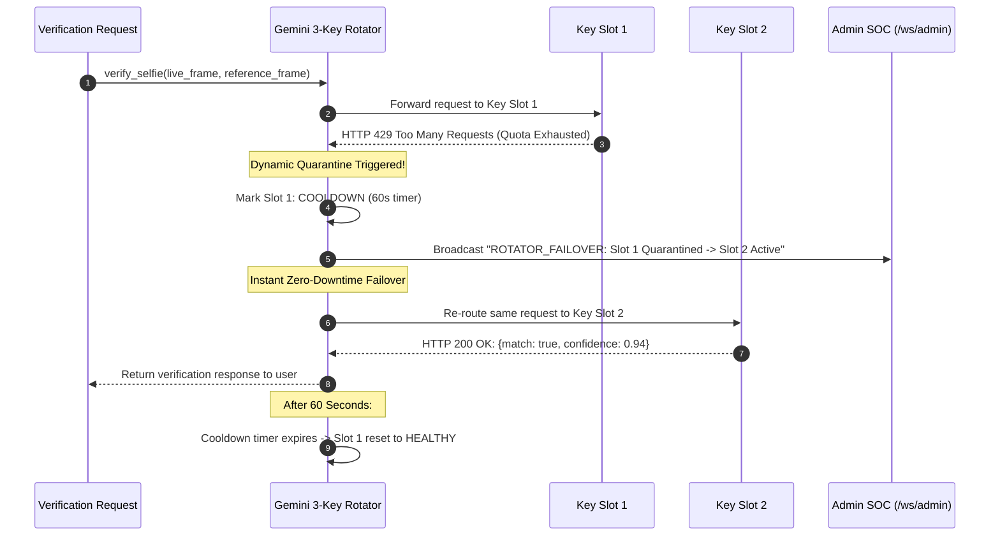

# 🔄 System Operational Mechanics & Workflow Manual (WORKING.md)

This document provides a complete operational guide to the **Cardless ATM Anti-Fraud Kiosk System (Sentinel Architecture)**. It describes end-to-end user journeys, system state transitions, real-time WebSocket protocol payloads, and threat mitigation mechanisms.

---

## 📑 Table of Contents

- [1. Operational Summary](#1-operational-summary)
- [2. End-to-End User Journeys](#2-end-to-end-user-journeys)
  - [Journey 1: Primary User Cardless Cash Withdrawal](#journey-1-primary-user-cardless-cash-withdrawal)
  - [Journey 2: Express Pre-Staged 10-Second Cash Dispense](#journey-2-express-pre-staged-10-second-cash-dispense)
  - [Journey 3: Gemini Shoulder-Surfing Detection & Privacy Shield Mode](#journey-3-gemini-shoulder-surfing-detection--privacy-shield-mode)
  - [Journey 4: Silent Duress Emergency Extraction & SOC Siren](#journey-4-silent-duress-emergency-extraction--soc-siren)
  - [Journey 5: Admin Emergency Kill Switch & Terminal Lockout](#journey-5-admin-emergency-kill-switch--terminal-lockout)
  - [Journey 6: Delegated Emergency Family Withdrawal](#journey-6-delegated-emergency-family-withdrawal)
  - [Journey 7: Gemini 3-Key Rotator Failover Recovery](#journey-7-gemini-3-key-rotator-failover-recovery)
- [3. System State Machine & Lifecycle](#3-system-state-machine--lifecycle)
- [4. WebSocket Protocol Specification](#4-websocket-protocol-specification)
  - [4.1 Kiosk Channel (`/ws/kiosk/{session_id}`)](#41-kiosk-channel-wskiosksession_id)
  - [4.2 Admin Channel (`/ws/admin`)](#42-admin-channel-wsadmin)
- [5. Threat Analysis & Security Mitigations](#5-threat-analysis--security-mitigations)
- [6. Troubleshooting & Diagnostics Playbook](#6-troubleshooting--diagnostics-playbook)

---

## 1. Operational Summary

The Sentinel Architecture replaces traditional card-reading ATMs with an **ephemeral out-of-band authentication model**:

```
[1. ATM Terminal]           [2. Mobile App]               [3. Cloud AI Engine]        [4. Cash Dispenser]
  Dynamic QR Code  ───▶  Biometric Fingerprint  ───▶  Gemini Vision Face Match  ───▶  Physical Cash Ejected
   (180s Timeout)          & Live Selfie Capture       (3-Key Dynamic Rotator)        (Atomic Decrement)
```

By decoupling session initiation (at the public terminal) from identity verification (on the customer's private personal device), the system achieves:
1. **Zero physical contact surface** for card skimmers or magnetic shims.
2. **Zero PIN exposure** to over-the-shoulder cameras or fake keypad overlays.
3. **Multi-factor certainty** uniting device ownership, biometric signature, and cloud facial verification.

---

## 2. End-to-End User Journeys

### Journey 1: Primary User Cardless Cash Withdrawal



---

### Journey 2: Express Pre-Staged 10-Second Cash Dispense



---

### Journey 3: Gemini Shoulder-Surfing Detection & Privacy Shield Mode



---

### Journey 4: Silent Duress Emergency Extraction & SOC Siren



---

### Journey 5: Admin Emergency Kill Switch & Terminal Lockout



---

### Journey 6: Delegated Emergency Family Withdrawal



---

### Journey 7: Gemini 3-Key Rotator Failover Recovery



---

## 3. System State Machine & Lifecycle

```
┌─────────────────────────────────┬─────────────────────────────────────────────────────────┐
│ State                           │ Transition Trigger                                      │
├─────────────────────────────────┼─────────────────────────────────────────────────────────┤
│ `CREATED`                       │ Terminal mounts, fetches session QR from backend.       │
│ `SCANNED`                       │ Mobile app scans QR, binds device & prestaged amount.   │
│ `BIOMETRICS_VERIFIED`           │ Device fingerprint / BiometricPrompt succeeds.          │
│ `AUTHORIZED`                    │ Gemini Vision confirms face >=0.85 & checks perimeter.   │
│ `DISPENSING`                    │ Terminal executes atomic withdrawal & ejects notes.     │
│ `COMPLETED`                     │ Banknotes collected; digital advice receipt rendered.   │
│ `TERMINATED`                    │ Admin triggers Emergency Kill Switch from SOC.          │
│ `EXPIRED`                       │ Session exceeds 180s TTL without completion.           │
└─────────────────────────────────┴─────────────────────────────────────────────────────────┘
```

---

## 4. WebSocket Protocol Specification

### 4.1 Kiosk Channel (`/ws/kiosk/{session_id}`)

#### Events

##### `QR_SCANNED`
```json
{
  "event": "QR_SCANNED",
  "status": "SCANNED",
  "prestaged_amount": 2000,
  "user_name": "Alex Mercer"
}
```

##### `BIOMETRICS_VERIFIED`
```json
{
  "event": "BIOMETRICS_VERIFIED",
  "status": "BIOMETRICS_VERIFIED"
}
```

##### `AUTHORIZED`
```json
{
  "event": "AUTHORIZED",
  "status": "AUTHORIZED",
  "user": {"id": "usr_alex_001", "full_name": "Alex Mercer", "account_balance": 25000.0},
  "prestaged_amount": 2000,
  "shoulder_surfing_detected": false,
  "disguise_detected": false,
  "is_duress": false
}
```

##### `DISPENSING_CASH`
```json
{
  "event": "DISPENSING_CASH",
  "status": "COMPLETED",
  "amount": 2000.0,
  "new_balance": 23000.0,
  "transaction_id": "tx_c8914b"
}
```

##### `SESSION_TERMINATED`
```json
{
  "event": "SESSION_TERMINATED",
  "type": "SESSION_TERMINATED",
  "reason": "Terminal lockout enforced by Central Risk Committee"
}
```

---

### 4.2 Admin Channel (`/ws/admin`)

##### `DURESS_TRIGGERED`
```json
{
  "type": "DURESS_TRIGGERED",
  "data": {
    "terminal": "KIOSK-EAST-01",
    "user_id": "usr_alex_001",
    "risk_score": 100,
    "timestamp": "2026-11-21T20:30:00.000Z"
  }
}
```

##### `BALANCE_UPDATED`
```json
{
  "type": "BALANCE_UPDATED",
  "user_id": "usr_alex_001",
  "new_balance": 23000.0
}
```

##### `ROTATOR_TELEMETRY`
```json
{
  "type": "ROTATOR_TELEMETRY",
  "data": {
    "active_slot": "KEY_1",
    "slots": [
      {"slot_id": "KEY_1", "status": "HEALTHY", "cooldown_remaining_sec": 0, "fail_count": 0},
      {"slot_id": "KEY_2", "status": "HEALTHY", "cooldown_remaining_sec": 0, "fail_count": 0},
      {"slot_id": "KEY_3", "status": "HEALTHY", "cooldown_remaining_sec": 0, "fail_count": 0}
    ]
  }
}
```

---

## 5. Threat Analysis & Security Mitigations

```
┌─────────────────────────────────┬───────────────────────────────────────────────────────┐
│ Attack Vector                   │ Sentinel Architectural Defense                        │
├─────────────────────────────────┼───────────────────────────────────────────────────────┤
│ Physical Magnetic Skimmers      │ Zero physical card slots exist on the kiosk.          │
│ Shims on EMV Chip Readers       │ Zero chip reader mechanisms exist on the kiosk.       │
│ Camera Pinhole PIN Recording    │ Zero PINs are typed on physical ATM hardware.         │
│ Shoulder-Surfing Peeking        │ Gemini Vision AI detects bystanders; Privacy Shield.  │
│ Physical Coercion / Duress      │ Silent Duress Mode dispenses decoy & alerts SOC.      │
│ Rogue Terminal Abuse            │ Central Kill Switch remotely terminates session.      │
│ Pre-Recorded Video / Deepfakes  │ Multimodal Gemini Vision checks skin texture & depth. │
│ Stolen Smartphone Attack        │ Requires phone lock + hardware fingerprint + selfie.  │
│ Network Sniffing & Replays      │ TLS/HTTPS and WSS WebSocket transport encryption.     │
└─────────────────────────────────┴───────────────────────────────────────────────────────┘
```

---

## 6. Troubleshooting & Diagnostics Playbook

### 1. Kiosk Displays "WebSocket Disconnected"
- Confirm FastAPI backend is active: `curl http://localhost:8000/health`.
- Verify terminal connection configuration in `atm-kiosk/src/App.tsx`.

### 2. Live Selfie Fails Verification
- Check Gemini Rotator health: `curl http://localhost:8000/api/gemini/status`.
- Ensure the user's reference photo exists via `GET /api/users/{id}/reference-photo`.

### 3. Insufficient Balance Error
- Check user balance on Dashboard or verify remaining delegation quota.

### 4. Running the E2E Integration Suite
```bash
python test_rotator_e2e.py
```
Validates backend database, rotator health, dynamic session, biometrics, facial verification, and atomic balance deduction.
